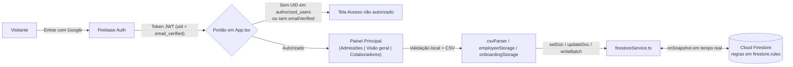

| **Instituição** | `Centro Universitário UDF` |
|---|---|
| **Curso** | `Ciência da Computação` |
| **Disciplina** | `Tendências em Ciência da Computação` |
| **Professor(a)** | `Kadidja Valéria` |

### Divisão de Responsabilidades do Grupo

| Integrante | RA / Identificação |
|---|---|
| `Pedro Henrique Cunha Amancio da Silva` | `45729620`


# Sistema de Gestão de Colaboradores

Aplicação web acadêmica de Recursos Humanos desenvolvida para demonstrar cadastro de colaboradores fictícios, importação validada por CSV, painel de indicadores e acompanhamento visual de admissões em linha do tempo de 7 dias, com autenticação Google (**Firebase Authentication**), persistência em nuvem (**Cloud Firestore**) e controle de acesso restrito por **UIDs autorizados**.

> **Documentação complementar do repositório**:
> - [Arquitetura técnica e fluxos](./docs/arquitetura.md)
> - [Testes e verificação de segurança](./docs/testes.md)
> - [Uso de inteligência artificial e Vibecode](./docs/uso-da-ia.md)
> - [Reflexão crítica (3 vantagens e 3 limitações)](./docs/reflexao-critica.md)
> - [Guia de evidências e capturas de tela](./docs/evidencias/README.md)

---

## Cronograma Acadêmico e Alinhamento das Etapas

| Data / Marco | Etapa da Atividade | Onde Consultar no Repositório |
|---|---|---|
| **08/10** | Definição do desafio | [Seção 2 — Desafio e escopo](#2-desafio-e-escopo) |
| **15/10** | Escolha e configuração da plataforma | [Seção 3 — Tecnologias utilizadas](#3-tecnologias-utilizadas) e [Seção 6 — Instalação e utilização](#6-instalação-e-utilização) |
| **22/10** | Integração Vibecode e IA | [Seção 7 — Uso de IA e Vibecode](#7-uso-de-inteligência-artificial-e-vibecode) e [`docs/uso-da-ia.md`](./docs/uso-da-ia.md) |
| **29/10** | Testes e verificação de segurança | [Seção 8 — Testes e segurança](#8-testes-e-segurança) e [`docs/testes.md`](./docs/testes.md) |
| **Documentação final** | Organização no GitHub, evidências e reflexão crítica | [`README.md`](./README.md), [`docs/reflexao-critica.md`](./docs/reflexao-critica.md) e [`docs/evidencias/README.md`](./docs/evidencias/README.md) |

---

## 1. Apresentação do Projeto

- **Nome do projeto**: Sistema de Gestão de Colaboradores
- **Descrição resumida**: Aplicação web responsiva (SPA em React + TypeScript + Vite) integrada ao Firebase Authentication e ao Cloud Firestore para gerenciar colaboradores fictícios e seus processos de admissão em três áreas integradas (**Admissões**, **Visão geral** e **Colaboradores**).
- **Objetivo geral**: Entregar um protótipo funcional, seguro e auditável de gestão de colaboradores e *onboarding*, demonstrando o uso combinado de desenvolvimento assistido por IA (*Vibecode*) no Google AI Studio com serviços em nuvem do Firebase.
- **Público-alvo**:
  - **Acadêmico**: Professores, avaliadores e estudantes da disciplina de Low Code / No Code / Vibecode.
  - **Operacional simulado**: Analistas e gestores de RH responsáveis por cadastros, cargas em CSV e checklists de integração com dados fictícios.
- **Problema identificado**: Controles manuais de admissões e cadastros em planilhas isoladas dificultam acompanhar prazos próximos de início, geram inconsistência em setores e e-mails duplicados, distorcem indicadores quando filtros são aplicados e expõem registros quando não há controle de acesso.
- **Resultado esperado**: Centralizar o cadastro com setores padronizados (`RH`, `TI`, `Financeiro`, `Operações`), validar importações CSV antes da gravação, destacar pendências próximas na linha do tempo de 7 dias, manter indicadores globais sempre atualizados sobre a base completa e restringir leitura/escrita apenas a contas Google autorizadas pelo administrador.

Link do Projeto: https://ai.studio/apps/450afd8d-1c4c-423b-8278-b95ee992f966
---

## 2. Desafio e Escopo

### Problema Motivador e Solução Adotada
Equipes administrativas sem um sistema dedicado perdem visibilidade sobre quais colaboradores estão prestes a iniciar e quais etapas operacionais (*documentação*, *acessos* e *integração*) ainda faltam. A solução organiza o fluxo em torno de três telas integradas com persistência em tempo real no Cloud Firestore, validação de e-mail único, pré-visualização segura de CSV e portão de acesso baseado em `authorized_users`.

### Funcionalidades Incluídas no Escopo
- Autenticação Google via pop-up (`signInWithPopup`) e bloqueio automático para visitantes e contas não listadas em `authorized_users`.
- Tela principal de **Admissões** com linha do tempo dos próximos 7 dias, seção **A agendar**, **Lista completa** com filtro de atrasos e checklist de 3 etapas (`0/3` a `3/3`).
- Tela de **Visão geral** com total de colaboradores, ativos, inativos, admissões em andamento/concluídas e distribuição percentual por setor calculada sempre sobre a base completa.
- Tela de **Colaboradores** com busca por nome sem acentos, filtros por setor e situação, cadastro/edição em painel lateral com opção **Iniciar admissão** e carga de 8 registros fictícios de demonstração.
- Importação de arquivos **CSV** com detecção de delimitador (`,` ou `;`), remoção de BOM UTF-8 e pré-via separando linhas **Válidas**, **Duplicadas** e **Inválidas** sem sobrescrever existentes.
- Migração opcional e confirmada de dados locais legados da versão 3.1 (`localStorage`) para o Cloud Firestore.

### O Que Não Faz Parte do Escopo
- Gestão de contas autorizadas (`authorized_users`) pela interface do aplicativo (cadastro/remoção ocorre exclusivamente pelo Console do Firebase).
- Exclusão individual de um colaborador específico na tabela (existem apenas edição para `Inativo` e limpeza total via **Limpar base**).
- Paginação server-side, anexos de arquivos, integração com folha de pagamento/e-Social ou múltiplas admissões para a mesma pessoa.
- Chamadas de inteligência artificial em tempo de execução dentro da aplicação.

---

## 3. Tecnologias Utilizadas

### Stack Confirmada no Projeto

| Tecnologia | Finalidade | Justificativa da Escolha |
|---|---|---|
| **Google AI Studio Build** | Ambiente de desenvolvimento assistido por IA (*Vibecode*) | Permitiu prototipar, evoluir e refinar os módulos da aplicação em ciclos rápidos com revisão contínua do código-fonte. |
| **React 19 + TypeScript 7** | Construção da interface modular e tipagem estática | Garante componentes reutilizáveis (`EmployeeDrawer`, `OnboardingSection`, `CsvImportModal`) e menor risco de erros de tipo em tempo de desenvolvimento. |
| **Vite 8** | Empacotador e servidor de desenvolvimento local (porta `3000`) | Compilação rápida em desenvolvimento e geração limpa do bundle estático de produção (`dist/`). |
| **Tailwind CSS v4 + Lucide React** | Estilização responsiva e iconografia | Facilitou construir o tema corporativo claro, a barra azul-marinho e a responsividade entre `320 px` e desktop sem CSS paralelo complexo. |
| **Firebase Authentication** | Login com conta Google (`GoogleAuthProvider`) | Elimina gestão manual de senhas e fornece token verificado (`uid`, `email_verified`) diretamente para o cliente e para as regras do banco. |
| **Cloud Firestore** | Banco NoSQL em tempo real na nuvem | Sincroniza colaboradores e admissões via `onSnapshot`, suporta gravações atômicas (`writeBatch`) e aplica validação declarativa em `firestore.rules`. |
| **ESLint + `@firebase/eslint-plugin-security-rules`** | Auditoria estática das regras de segurança | Valida `firestore.rules` contra falhas comuns de autorização e controle de acesso antes da publicação. |

> **Observação de auditoria sobre `package.json`**: As dependências `express`, `dotenv`, `@google/genai` e `motion` constam no `package.json` por herança do template inicial do Google AI Studio, mas **não são importadas nem utilizadas em tempo de execução** pela aplicação atual.

### Comparação com Alternativas Low Code / No Code

> **Transparência metodológica**: Somente a pilha **Google AI Studio + React/Vite + Firebase** foi efetivamente implementada e testada neste projeto. A comparação com **Bubble**, **Airtable** e **AppSheet** abaixo baseia-se em **avaliação técnica documental** das plataformas, e não em protótipos paralelos executados.

| Critério | Google AI Studio + React + Firebase *(Testado no projeto)* | Bubble *(Avaliação técnica)* | Airtable + Interfaces *(Avaliação técnica)* | AppSheet *(Avaliação técnica)* |
|---|---|---|---|---|
| **Flexibilidade de UI** | Alta (linha do tempo de 7 dias e pré-via CSV sob medida) | Alta dentro do editor visual próprio | Média (focada em visões de tabela/kanban/formulário) | Restrita a visões padronizadas |
| **Controle de segurança** | Regras auditáveis em `firestore.rules` + ESLint | Regras visuais de privacidade da plataforma | Controle de permissões por workspace/plano | Regras em expressões ligadas à conta Google/Microsoft |
| **Portabilidade** | Código React/TS exportável para GitHub | Preso à infraestrutura da plataforma | Preso ao ecossistema Airtable | Preso ao ecossistema Google Cloud/AppSheet |
| **Esforço de revisão** | Requer revisão técnica do código e das regras | Baixo em código, médio na lógica visual | Baixo, porém limitado para regras customizadas | Baixo a médio |

---

## 4. Funcionalidades

### Admissões *(Tela principal)*
- Exibe 4 indicadores rápidos: *Em andamento*, *Início próximo (0–2d)*, *A agendar (sem data)* e *Prontas para começar (3/3)*.
- Apresenta a **Linha do tempo dos próximos 7 dias** (`Hoje`, `Amanhã` e próximos 5 dias) com rolagem horizontal restrita à grade em tablets e 7 colunas em telas `xl`, além de empilhamento vertical no celular.
- Separa processos sem data na seção **A agendar** e oferece visão **Lista completa** com filtros por status, setor e atalho **Ver atrasos**.
- Ao clicar em um cartão, abre a ficha de checklist (`OnboardingDrawer`) com as 3 tarefas (*Validar documentação*, *Solicitar acesso aos sistemas*, *Agendar integração*) e campo opcional de data prevista de início. Concluir a 3ª etapa muda automaticamente o cartão para **Pronta para começar** e a ficha para **Concluída**; desmarcar qualquer tarefa retorna para **Em andamento**.

### Visão geral
- Calcula em tempo real os totais da **base completa** (mesmo quando existem filtros ativos na aba Colaboradores): total, ativos, inativos e admissões em andamento/concluídas.
- Exibe a distribuição por setor (`RH`, `TI`, `Financeiro`, `Operações`) com contagem de ativos/inativos e barra proporcional, além de atalhos para novo cadastro, CSV ou carga de exemplo fictício quando a base está vazia.

### Colaboradores
- Lista todos os colaboradores cadastrados com busca por nome insensível a acentos e maiúsculas, filtro por setor e filtro por situação (`Todas`, `Ativo`, `Inativo`).
- Permite cadastrar e editar em painel lateral (`EmployeeDrawer`) com validação imediata de campos obrigatórios, limites alinhados ao Firestore (`nome` 2–160 chars, `email` 5–254 chars) e detecção de e-mail já pertencente a outro colaborador.
- Permite marcar **Iniciar admissão** durante o cadastro/edição (quando ainda não houver admissão vinculada) ou diretamente na linha da tabela.
- Oferece botão **Carregar dados de exemplo** (8 colaboradores fictícios do domínio `@empresa-modelo.com.br`) e limpeza total confirmada via **Limpar base**.

### Autenticação e controle de acesso
- Visitantes sem sessão veem apenas a tela **Entrar no painel de RH** com login Google via `signInWithPopup`.
- Após autenticar, o sistema confirma `emailVerified === true` e consulta `/authorized_users/{uid}` diretamente no servidor (`getDocFromServer`).
- Contas sem cadastro em `authorized_users` visualizam a tela **Acesso não autorizado**, exibindo o próprio `UID` com botão **Copiar UID**, **Verificar novamente** e **Sair e trocar de conta**.
- Ao clicar em **Sair**, o estado em memória é limpo imediatamente e a interface retorna à tela de login.

### Importação CSV
- Aceita envio por seleção de arquivo ou arrastar e soltar, além de disponibilizar download do modelo (`colaboradores_demonstracao.csv`) com cabeçalho `Nome,E-mail profissional,Setor,Situação`.
- Suporta `,` e `;`, remove BOM UTF-8 e exibe uma pré-via detalhada contabilizando registros **Válidos**, **Duplicados** (ignorados sem sobrescrever existentes) e **Inválidos** antes da gravação em lote no Firestore.

---

## 5. Arquitetura e Funcionamento

A aplicação opera inteiramente no navegador como SPA React conectada aos serviços do Firebase. O código-fonte em `src/` é organizado em componentes de interface (`src/components/`), utilitários de domínio e validação (`src/utils/`), definições de tipos (`src/types/employee.ts`) e inicialização do SDK (`src/firebase.ts`).



- **Documentação técnica completa**: consulte [`docs/arquitetura.md`](./docs/arquitetura.md) para detalhes de todos os arquivos, schema de `firebase-blueprint.json`, regras de `firestore.rules` e fluxo de migração da v3.1.

---

## 6. Instalação e Utilização

### Pré-requisitos
- **Node.js 20+** (ou **Bun**) e `npm` instalado.
- Conta no **Firebase Console** com acesso ao projeto configurado em `firebase-applet-config.json` (ou projeto próprio equivalente).

### Instalação das Dependências e Execução Local

```bash
# 1. Instalar dependências
npm install

# 2. Executar servidor de desenvolvimento (porta 3000)
npm run dev

# 3. Verificar tipagem TypeScript
npm run lint

# 4. Gerar build de produção
npm run build
```

### Variáveis de Ambiente (`.env.example`)
O arquivo `.env.example` traz as chaves modelo do ambiente AI Studio (`GEMINI_API_KEY` e `APP_URL`). **O aplicativo atual não exige nenhuma chave secreta no frontend**, pois utiliza exclusivamente a configuração pública de cliente Web do Firebase em `firebase-applet-config.json`. Nunca crie nem envie arquivos `.env` reais para o GitHub.

> **Nota sobre `firebase-applet-config.json`**: Os campos `apiKey`, `projectId`, `appId`, `authDomain` e `firestoreDatabaseId` presentes nesse arquivo são identificadores públicos necessários para o navegador conectar-se ao Firebase. A proteção dos dados não depende do sigilo desse arquivo, e sim da autenticação Google e das regras declarativas em [`firestore.rules`](./firestore.rules).

### Configuração do Firebase e Primeiro Acesso

1. No [Firebase Console](https://console.firebase.google.com/), abra o projeto indicado em `firebase-applet-config.json` (`gen-lang-client-0658766196`).
2. Em **Authentication → Sign-in method**, ative o provedor **Google** e salve. Em **Authentication → Settings → Authorized domains**, inclua `localhost`, `127.0.0.1` e o domínio publicado.
3. Em **Firestore Database**, selecione o banco indicado em `firestoreDatabaseId` (`ai-studio-sistemadegestode-450afd8d-1c4c-423b-8278-b95ee992f966`) e confirme que as regras de `firestore.rules` estão publicadas.
4. Abra o aplicativo e clique em **Entrar com Google**. Como seu UID ainda não estará liberado, será exibida a tela **Acesso não autorizado** com seu **UID** e o botão **Copiar UID**.
5. No **Firestore Database**, crie a coleção `authorized_users`, adicione um documento com **ID exatamente igual ao UID copiado** (com campos informativos opcionais como `nome` e `email`) e salve.
6. Volte ao aplicativo e clique em **Verificar novamente** para acessar o painel.

### Como Utilizar as Principais Funcionalidades
1. Na primeira visita, acesse **Colaboradores** (ou **Visão geral**) e clique em **Carregar dados de exemplo** ou **Importar CSV** (use o botão **Baixar CSV modelo** se desejar testar com o arquivo padrão).
2. Cadastre novos colaboradores clicando em **Novo colaborador** no cabeçalho e marque **Iniciar admissão** para gerar o checklist automaticamente.
3. Na aba **Admissões**, clique em qualquer cartão para marcar/desmarcar tarefas (`0/3` a `3/3`) e ajustar a data prevista de início.

---

## 7. Uso de Inteligência Artificial e Vibecode

A inteligência artificial (**Google AI Studio Build**) atuou exclusivamente como **ferramenta de apoio ao desenvolvimento**, sem qualquer integração de modelos de IA dentro da aplicação final. O sistema foi construído de forma iterativa entre as versões **v1** (diretório + CSV), **v2** (Visão geral + checklist de admissão), **v3/v3.1** (linha do tempo de 7 dias + correção mobile), **v4** (Firebase Auth + Cloud Firestore) e **Auditoria Final**.

- Todas as entregas geradas por IA passaram por revisão técnica, resultando em correções concretas (atualização determinística de estado no React 19, eliminação de overflow horizontal em `390 px`, alinhamento de tamanho mínimo de nome no CSV com `firestore.rules`, verificação prévia de `emailVerified` e diferenciação visual de toasts de erro).
- **Transparência sobre histórico**: Os primeiros prompts literais anteriores à compactação da sessão não estão disponíveis na íntegra e não foram inventados; na documentação detalhada constam os prompts preservados e um **exemplo representativo devidamente identificado**.

Consulte o registro completo em [`docs/uso-da-ia.md`](./docs/uso-da-ia.md).

---

## 8. Testes e Segurança

A tabela abaixo resume os testes reais executados nesta auditoria e os cenários que permanecem pendentes de execução manual no Firebase Console / navegador autenticado. **Nenhum teste não executado foi marcado como aprovado.**

| Teste | Descrição | Resultado | Situação |
|---|---|---|---|
| **Checagem TypeScript (`npm run lint`)** | Execução de `tsc --noEmit` em toda a base `src/` | Zero erros de tipagem ou importações inválidas | **Aprovado** |
| **Build de produção (`npm run build`)** | Execução de `vite build` | Bundle gerado com sucesso em `dist/` | **Aprovado** |
| **Lint das regras (`npx eslint firestore.rules`)** | Análise com `@firebase/eslint-plugin-security-rules` | Zero erros ou vulnerabilidades apontadas | **Aprovado** |
| **Auditoria de pacotes (`bun audit`)** | Checagem somente leitura de vulnerabilidades no `bun.lock` | 3 avisos em dependências transitivas (`@grpc/grpc-js` e `minimatch`), sem segredos expostos | **Aprovado** *(informativo)* |
| **Regras de domínio (`tsx`)** | Testes unitários em `employeeStorage.ts`, `csvParser.ts` e `onboardingStorage.ts` | Todas as asserções passaram (`ALL_UNIT_ASSERTIONS_PASSED`), incluindo rejeição de nome com 1 char no CSV e transições `0/3` ↔ `3/3` | **Aprovado** |
| **Visitante e responsividade (Chromium)** | Acesso sem login a `http://127.0.0.1:3000` em `320`, `390` e `1280 px` | `exceptions: []`, botão de login visível, dados protegidos ocultos e zero rolagem horizontal | **Aprovado** |
| **Emulador local Firestore** | Simulação local com `firebase emulators:exec` | Bloqueado no sandbox por ausência do binário `java` (`java: not found`) | **Não executado** |
| **Fluxo ao vivo: Conta não autorizada** | Login Google real sem documento em `authorized_users` | Requer interação OAuth Google real no preview | **Não executado** |
| **Fluxo ao vivo: Cadastro de UID + Revalidação** | Inserção do 1º UID no Console e clique em **Verificar novamente** | Requer ação manual no Console do Firebase | **Não executado** |
| **Fluxo ao vivo: Conta autorizada + CRUD + Sair** | Leitura/escrita real no Firestore, importação CSV e limpeza ao sair | Requer conta Google autorizada real no preview | **Não executado** |

Consulte a matriz detalhada (`T-01` a `T-12`) e o checklist de segurança em [`docs/testes.md`](./docs/testes.md).

---

## 9. Reflexão Crítica: Três Vantagens e Três Limitações

### Três Vantagens
1. **Agilidade no desenvolvimento iterativo com auxílio de IA**: Permitiu evoluir rapidamente de um cadastro simples com CSV para uma linha do tempo interativa de 7 dias integrada à nuvem em poucas iterações.
2. **Integração direta entre autenticação e banco de dados na nuvem**: O Firebase Authentication com Login Google e o Cloud Firestore dispensaram servidor próprio, garantindo sincronização em tempo real e proteção via `firestore.rules`.
3. **Facilidade de manutenção e validação modular**: A separação clara entre utilitários de validação (`csvParser.ts`, `onboardingStorage.ts`, `employeeStorage.ts`), serviço Firestore e componentes React facilitou localizar lacunas e validá-las de forma isolada.

### Três Limitações
1. **Dependência de serviços externos e configuração manual em nuvem**: O funcionamento completo depende do projeto Firebase, da ativação do Login Google, dos domínios autorizados e do cadastro manual de UIDs em `authorized_users` no Console (além das cotas gratuitas).
2. **Necessidade contínua de revisar e testar código gerado por IA**: A auditoria detectou lacunas reais produzidas ao longo das iterações (como divergência de tamanho mínimo de nome no CSV vs. `firestore.rules`, ausência de checagem prévia de `emailVerified` e toast de erro com ícone verde).
3. **Limitações de escalabilidade e funções administrativas ausentes**: Não há exclusão individual de colaborador na tabela, não existe painel interno para gerenciar `authorized_users`, as assinaturas `onSnapshot` carregam toda a coleção sem paginação e a unicidade de e-mail não é imposta em concorrência estrita no servidor.

Veja a análise expandida em [`docs/reflexao-critica.md`](./docs/reflexao-critica.md).

---

## 10. Próximos Passos

### Já Implementado
- Portão de acesso com Login Google, validação de `emailVerified` e bloqueio por `authorized_users` no cliente e em `firestore.rules`.
- Linha do tempo de 7 dias, seção *A agendar*, *Lista completa*, ficha lateral responsiva e checklist `0/3` a `3/3`.
- Painel de indicadores da base completa, busca/filtros de colaboradores, importação CSV com pré-via e migração opcional de dados locais v3.1.

### Propostas Futuras de Evolução
- Implementar exclusão individual segura de colaborador (removendo também a admissão vinculada em `writeBatch`).
- Adicionar `ErrorBoundary` global em React e paginação/limitação de consultas no Firestore para bases maiores.
- Criar painel administrativo restrito ou Cloud Function dedicada para gerenciar `authorized_users` e unicidade de e-mail no servidor.
- Remover dependências herdadas do template não utilizadas em runtime (`express`, `@google/genai`, `motion`, `dotenv`).

---
