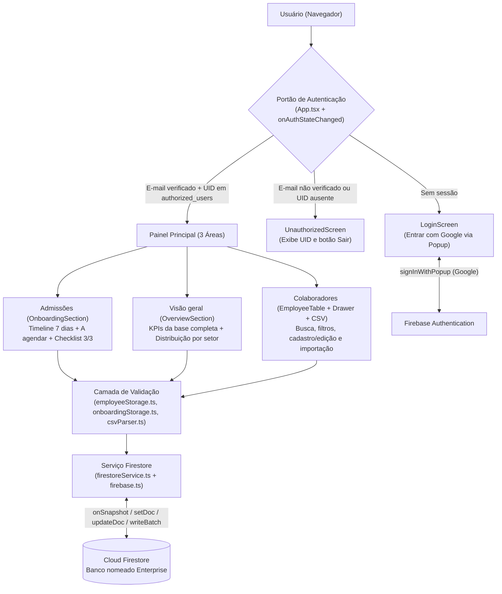

# Arquitetura Técnica — Sistema de Gestão de Colaboradores

Este documento detalha a arquitetura técnica, o fluxo de autenticação, a comunicação com o Cloud Firestore, a organização dos módulos em `src/` e as regras de segurança aplicadas no projeto.

---

## 1. Visão Geral da Arquitetura

A aplicação funciona como uma **Single Page Application (SPA)** construída com **React 19**, **TypeScript**, **Vite 8** e **Tailwind CSS v4**, conectada diretamente aos serviços gerenciados do **Firebase** (**Firebase Authentication** e **Cloud Firestore**) pelo SDK Web modular (`firebase` v13.3.0).

Não há servidor backend próprio em execução (`express`, `dotenv`, `@google/genai` e `motion` permanecem listados em `package.json` apenas como herança do template inicial do Google AI Studio e não são importados pelo código-fonte).

---

## 2. Organização dos Arquivos e Componentes

| Caminho | Responsabilidade Real |
|---|---|
| `src/main.tsx` | Ponto de entrada React (`createRoot`) e importação de `src/index.css`. |
| `src/App.tsx` | Orquestrador global: estado do portão de autenticação (`loading`, `visitor`, `checking-permission`, `unauthorized`, `authorized`), assinaturas `onSnapshot`, filtros da listagem, detecção de migração v3.1 e notificações (`toast`). |
| `src/firebase.ts` | Inicializa `initializeApp(firebaseConfig)`, `db = getFirestore(app, firebaseConfig.firestoreDatabaseId)`, `auth`, `googleProvider` (`select_account`), `testConnection()` e `handleFirestoreError()`. |
| `src/types/employee.ts` | Tipos e constantes padronizadas: `SETORES` (`RH`, `TI`, `Financeiro`, `Operações`), `SITUACOES` (`Ativo`, `Inativo`), `ONBOARDING_DEFAULT_TASKS` (3 etapas), `Employee`, `Onboarding`, `AppTab`. |
| `src/components/AuthScreens.tsx` | Telas `LoginScreen`, `CheckingAuthScreen` e `UnauthorizedScreen` (com cópia rápida de UID e botão `Verificar novamente`). |
| `src/components/OnboardingSection.tsx` | Tela principal de **Admissões**: indicadores, linha do tempo dos próximos 7 dias, seção **A agendar**, **Lista completa** com filtros e início rápido de admissão. |
| `src/components/OnboardingCard.tsx` | Cartão de admissão com nome, setor, progresso `0/3` a `3/3`, barras segmentadas (`Doc.`, `Acessos`, `Integr.`) e estado visual semântico. |
| `src/components/OnboardingDrawer.tsx` | Ficha lateral (desktop) / tela cheia (mobile) para marcar/desmarcar as 3 etapas e definir ou remover `dataPrevistaInicio`. |
| `src/components/OverviewSection.tsx` | Indicadores consolidados sobre a base completa (total, ativos, inativos, admissões em andamento/concluídas e proporção por setor). |
| `src/components/EmployeeTable.tsx` | Tabela responsiva de colaboradores com estados vazios, badges de situação/admissão e ações de iniciar/ver admissão ou editar. |
| `src/components/EmployeeDrawer.tsx` | Painel lateral para cadastro e edição com validação imediata, detecção de e-mail duplicado e opção **Iniciar admissão**. |
| `src/components/CsvImportModal.tsx` | Modal de upload/arrastar CSV, download de modelo (`DEMO_CSV_CONTENT`) e tabela prévia de análise. |
| `src/utils/employeeStorage.ts` | Normalização de e-mail e texto de busca, limites alinhados ao Firestore (`2..160` e `5..254`), dados fictícios de demonstração e leitura/limpeza do `localStorage` legado (`sgc_colaboradores_v1`). |
| `src/utils/onboardingStorage.ts` | Cálculo de datas locais (`YYYY-MM-DD`), classificação visual da linha do tempo (`concluida`, `atrasada`, `inicio-proximo`, `em-andamento`, `a-agendar`), alternância de tarefas e leitura/limpeza do `localStorage` legado (`sgc_admissoes_v1`). |
| `src/utils/csvParser.ts` | Analisador de CSV (UTF-8 BOM, `,` ou `;`, cabeçalhos flexíveis) que classifica linhas em `valid`, `duplicate` e `invalid`. |
| `src/utils/firestoreService.ts` | Operações CRUD, `writeBatch` atômico para cadastro com admissão, importação em lotes de até 400 operações, migração assistida v3.1 e limpeza total da base. |

---

## 3. Fluxo de Autenticação e Controle de Acesso

1. **Visitante**: Ao abrir a página, `onAuthStateChanged` inicia em `loading` e, sem usuário autenticado, muda para `visitor`, renderizando `LoginScreen`. Nenhuma coleção protegida é assinada.
2. **Autenticação Google**: O usuário clica em **Entrar com Google**, acionando `signInWithPopup(auth, googleProvider)`. Erros comuns (`auth/popup-closed-by-user`, `auth/popup-blocked`) são tratados com mensagens amigáveis.
3. **Verificação de Permissão (`verifyUserPermission`)**:
   - Primeiro confirma `user.emailVerified === true` (alinhado com `isVerifiedUser()` das regras do Firestore).
   - Em seguida executa `checkUserAuthorization(uid)` com `getDocFromServer(doc(db, 'authorized_users', uid))` — garantindo verificação direta no servidor e não em cache local.
4. **Bloqueio de Não Autorizados**: Se o documento não existir ou o Firestore retornar `permission-denied`, o estado é limpo (`resetDisplayedData()`) e `UnauthorizedScreen` exibe o e-mail, o **UID** para envio ao administrador e os botões **Verificar novamente** e **Sair e trocar de conta**.
5. **Saída (`handleSignOut`)**: Chama `signOut(auth)`, limpa `employees`, `onboardings`, filtros e gavetas abertas, retornando imediatamente para `LoginScreen`.

---

## 4. Modelo de Dados e Regras de Segurança (`firestore.rules` e `firebase-blueprint.json`)

O banco no Cloud Firestore (`ai-studio-sistemadegestode-450afd8d-1c4c-423b-8278-b95ee992f966`, projeto `gen-lang-client-0658766196`) possui três coleções principais:

- **`/authorized_users/{uid}`**:
  - `get`: permitido apenas quando `request.auth != null && request.auth.uid == uid`.
  - `list`, `create`, `update`, `delete`: **bloqueados (`if false`)** para usuários do aplicativo — somente administradores pelo Console do Firebase gerenciam a lista.
- **`/colaboradores/{colaboradorId}`**:
  - Leitura (`get`, `list`) e gravação (`create`, `update`, `delete`): exigem `isAuthorizedUser()` (`request.auth != null`, `email_verified == true` e existência de `/authorized_users/$(request.auth.uid)`).
  - Valida chaves permitidas (`hasOnly`), `id == colaboradorId`, `nome` entre `2` e `160` caracteres, `email` entre `5` e `254` caracteres com regex, `setor` em `['RH', 'TI', 'Financeiro', 'Operações']`, `situacao` em `['Ativo', 'Inativo']`, `atualizadoEm` (`10..40` chars) e `atualizadoPorUid == request.auth.uid` quando presente.
- **`/admissoes/{admissaoId}`**:
  - Exige `isAuthorizedUser()`.
  - Impõe `data.id == data.colaboradorId` e `admissaoId == data.id`, garantindo no máximo **uma admissão por colaborador** no banco.
  - Exige `existsAfter(/databases/$(database)/documents/colaboradores/$(incoming().colaboradorId))` na criação (suportando criação atômica em `writeBatch` junto ao colaborador).
  - Valida exatamente 3 tarefas no array `tarefas`, formato opcional `YYYY-MM-DD` em `dataPrevistaInicio` e imutabilidade de `id`, `colaboradorId` e `criadaEm` em atualizações.

---

## 5. Fluxos Principais de Dados

### Cadastro, Consulta e Edição de Colaboradores
1. **Consulta**: `subscribeEmployees` e `subscribeOnboardings` mantêm listeners `onSnapshot` ativos apenas enquanto `authState === 'authorized'`. Os dados exibidos na tabela passam por filtro em memória (`searchQuery`, `setorFilter`, `situacaoFilter`), enquanto `OverviewSection` lê sempre o array completo.
2. **Cadastro Manual**: `EmployeeDrawer` valida obrigatoriedade, limites e e-mail único (normalizado com `trim().toLowerCase()`). Se **Iniciar admissão** estiver marcado, `createEmployeeInFirestore` grava colaborador e admissão em uma única transação `writeBatch`.
3. **Edição**: Atualiza os dados do colaborador via `updateDoc`; caso ainda não tenha admissão e o usuário marque **Iniciar admissão**, cria o documento em `admissoes/{colaboradorId}`.

### Importação CSV
1. O arquivo `.csv` é lido via `FileReader` (UTF-8) no navegador.
2. `parseAndValidateCsv` remove BOM UTF-8, detecta `,` ou `;`, valida cabeçalhos (`Nome`, `E-mail profissional`, `Setor`, `Situação`) e classifica cada linha em **Válido**, **Duplicado** (já existente na base ou repetido no CSV) ou **Inválido**.
3. Somente após confirmação do usuário, os registros válidos são gravados via `writeBatch` (em blocos de até 400 documentos), sem sobrescrever existentes.
