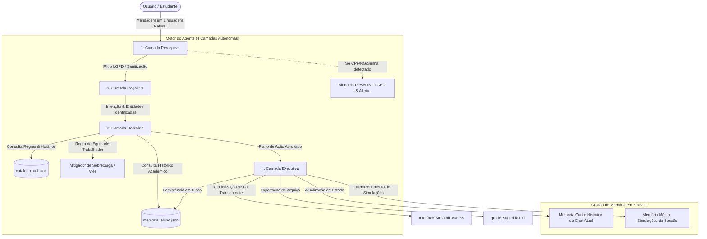

# ARCHITECTURE - GradeBot

## 1. Visão Arquitetural
O **GradeBot** é um Agente Conversacional Autônomo orientado a regras e metas, desenhado para resolver o problema de montagem de grade horária acadêmica, validação rigorosa de pré-requisitos e mitigação ativa de sobrecarga estudantil. O sistema opera **100% offline e local**, sem requisições para LLMs em nuvem.

## 2. As 4 Camadas do Agente
1. **Camada Perceptiva (`PerceptiveLayer`)**:
   - Sanitização de entrada.
   - Privacy by Design: Expressões regulares avançadas que detectam CPF (formatado e dígitos puros), RG e senhas antes de qualquer processamento ou log.
2. **Camada Cognitiva (`CognitiveLayer`)**:
   - Reconhecimento de intenções: `MONTAR_GRADE`, `CONCLUIR_DISCIPLINA`, `CONSULTAR_PREREQUISITO`, `VER_HISTORICO`, `AUDITAR_ETICA`, `LISTAR_CATALOGO`, `LIMPAR_MEMORIA`, `AJUDA`.
   - Extração de códigos de disciplinas e parâmetros contextuais.
3. **Camada Decisória (`DecisionalLayer`)**:
   - Grafo de pré-requisitos direcionado.
   - Matriz de compatibilidade temporal (Dia da semana x Turno).
   - Mecanismo de Equidade: Limite de disciplinas de carga "Alta" para estudantes trabalhadores.
4. **Camada Executiva (`ExecutiveLayer`)**:
   - Construção da resposta com feedback visual (Markdown, status e badges).
   - Disparo de efeitos colaterais (escrita em `memoria_aluno.json` e geração de `grade_sugerida.md`).

## 3. Gestão de Memória
- **Curta:** Gerenciada no `st.session_state.messages` com limitação de contexto.
- **Média:** Armazena cenários simulados na sessão (`st.session_state.simulacoes_sessao`).
- **Longa:** Persistida no arquivo local `memoria_aluno.json` com histórico de aprovações.
